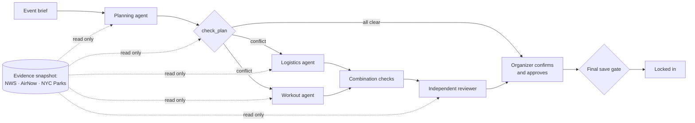

# FieldDay

<!-- Owner: shared -->
**Plan outdoor group workouts in NYC parks, and know they're safe before anyone shows up.**

Give it a brief. FieldDay picks a park, time and workout, then checks weather, rain, air quality, space and
equipment. When something fails, Claude agents propose fixes. You confirm what only you can see, then lock it in.

**[Live demo →](https://field-day-sepia.vercel.app)** · by Jian Ting Li and Yadan Taino


<sub>Local build · recorded weather · stub agents</sub>

## Highlights

- **Agents propose, code decides.** 4 Claude agents return validated JSON. A deterministic harness owns all state
  and the final save gate.
- **Unknown is never a pass.** Missing or stale data blocks lock-in. A gentler workout never excuses heat, rain or
  bad air.
- **Every fact cites its evidence:** source, time, place, and whether it's live, recorded or the organizer's word.
- **Say what changed in plain words.** One sentence becomes a list of changes you approve before anything moves.
- **Measured.** 12 evals written before the first run. 4 agents fixed 5 of 5 conflicts; Planning alone fixed 3.
  [Results](#eval-results)
- **Bounded.** At most 7 agent runs per request, with caps on tokens, cost and time, plus rate limits.
- **700+ tests**, none calling a live API or the model.



**Stack:** Next.js 16 · React 19 · TypeScript · Zod · Tailwind 4 · Claude API · Neon Postgres · Vercel · Vitest \
**Data:** National Weather Service · AirNow · NYC Parks Open Data (29 parks) \
**Never:** books venues, files permits, takes payment or messages attendees.

---

# For the team

## How we work
<!-- Owner: shared -->
- [CLAUDE.md](CLAUDE.md): ownership, PRD rules, done checklist (Claude Code reads it automatically)
- [TASKS.md](TASKS.md): tasks per person, each linked to an issue
- [worklog/](worklog/): read the other person's log before touching their work
- [docs/decisions.md](docs/decisions.md): decisions
- **Flow:** branch from `develop` → one task per PR → the other person reviews → merge → `develop` to `main` once tested

## Getting started
<!-- Owner: JT -->
Node 24 (`nvm use`).

```bash
npm install
cp .env.example .env.local   # add your own keys
npm run dev                  # http://localhost:3000
```

| Variable | What it does |
|---|---|
| `FIELDDAY_AGENTS` | `stub` (default, free) or `real` (calls Claude) |
| `ANTHROPIC_API_KEY` | Your key, for real agents |
| `ANTHROPIC_MODEL` | Default `claude-haiku-5-5` |
| `FIELDDAY_DATA_MODE` | `fixture` (default, recorded) or `live` |
| `NWS_USER_AGENT` | Live weather (NWS needs an identifying User-Agent) |
| `AIRNOW_API_KEY` | Live air quality |
| `DATABASE_URL` | Neon Postgres, set by Vercel. Without it, data lives in memory |

| Script | |
|---|---|
| `npm run dev` | Run the app |
| `npm test` | Tests (no live API calls) |
| `npm run typecheck` | Route types + type check |
| `npm run lint` | Lint |
| `npm run build` | Production build |
| `npm run db:reset` | Empty the hosted database (type `RESET`) |

### Deployed demo
[field-day-sepia.vercel.app](https://field-day-sepia.vercel.app): Vercel (team Calm Forge, `iad1`), real agents on
shared demo credits, live weather and air quality. Demo events always use recorded scenarios.

- **Rate limits** (real agents; D-JT19-1, D-JT24-10). Over a limit: `429`, nothing runs. Counted in memory per server.

  | | Per visitor / hour | Total / day |
  |---|---|---|
  | Agent runs (draft, change, alternatives) | 18 | 180 |
  | Reading what changed | 40 | 400 |
  | New events (every mode) | 20 | 300 |

- **Spend limit:** set a monthly cap on the Anthropic workspace. It's the backstop.
- **Demo label** (D-JT19-2, D-JT24-2): a banner on every page; locked-in plans say "demo only" while anything is
  unreviewed.
- **Reset:** Actions → "Reset database" → type `RESET` (needs the `DATABASE_URL` secret). Demo events come back on
  the next server start, seeded with stub agents (no credits).
- **Time limit** (D-JT19-3): routes allow 300 s; agents stop at 240 s.

## Architecture
<!-- Owner: JT -->
| Part | Where | Job |
|---|---|---|
| Contracts | `src/contracts/` | Zod schemas for every handoff |
| Harness | `src/server/` | Owns state, evidence, `check_plan`, budgets, approval, final save gate. Code, not an agent |
| Agents | `src/server/agents/` | Planning, Logistics, Workout, Reviewer. Read-only tools, validated JSON |
| API | `src/app/api/` | The UI's only way in (endpoints in `src/contracts/api.ts`) |

- **Workflow:** plan → check → Logistics + Workout in parallel → combination checks → review → ≤1 revision →
  approval → save gate. Draft a plan runs it all when the draft fails (D-JT24-4).
- **Checks** come only from `check_plan` (D-JT24-3). A confirmation covers space, surface or permit at one park and
  time (D-JT24-1). A reported problem fails that check until a newer confirmation clears it (D-JT24-12).
- **Something changed?** (D-JT28-1): `changes/read` turns text into a list (one model call, rules as fallback).
  `changes/apply` saves brief changes and re-plans, re-checks reports, and keeps the rest as notes with an answer.

## Features and status
<!-- Each person edits only their own rows. Status: placeholder · stub · in progress · done -->
| Feature | Owner | Status |
|---|---|---|
| Contracts | Shared | done (v0) |
| Agent runner | JT | done |
| Agent tools | JT | done |
| Evidence snapshots, freshness | JT | done |
| Heat / AQI policies | JT | done (unreviewed demo policy) |
| Logistics rules | JT | done |
| check_plan | JT | done (all rules real, no placeholders) |
| Orchestrator | JT | done; `FIELDDAY_AGENTS=real` picks real agents; API routes not on it yet (JT-14) |
| Lifecycle, approval | JT | done (states, versions, approval invalidation, stale-result rejection; space and surface confirmations tied to the workout layout, JT-22) |
| Final save gate | JT | stub (version, approval, hard constraints only) |
| Persistence | JT | in-memory stub |
| Event Logistics agent | JT | done; the orchestrator and evals use it with `FIELDDAY_AGENTS=real`; API routes not on it yet (JT-14) |
| Independent Reviewer agent | JT | done; the orchestrator and evals use it with `FIELDDAY_AGENTS=real`; API routes not on it yet (JT-14) |
| Planning agent | Yadan | built and tested (one live run); app still uses the stub until JT picks how to switch |
| Workout agent | Yadan | built and tested (one live run); app still uses the stub until JT picks how to switch |
| Workout rules | Yadan | done (equipment, duration, space, surface) |
| Workout templates | Yadan | 3 beginner templates, pending instructor review |
| UI | Yadan | done: event list, brief form, workspace, alternatives, confirm/approve/finalize, states; Claymorphism UI system |

## Data sources
<!-- Each person edits only their own sources. Status: proposed · tested · live · fixture-backed -->
| Source | Owner | Status |
|---|---|---|
| NYC Parks Open Data | JT | in use: 10 curated parks (D-020); eval scenarios use fixture parks; live mode untested in CI |
| National Weather Service | Yadan | tested; fixture-backed (live mode needs `NWS_USER_AGENT`) |
| AirNow | Yadan | tested live; fixture-backed (live mode needs `AIRNOW_API_KEY`) |
| Workout templates | Yadan | 3 beginner templates, pending instructor review |

## UI and screens
<!-- Owner: Yadan -->
Not started.

## Eval results
<!-- Owner: JT -->
First real run, 2026-10-28: all four agents, `claude-haiku-5-5`, fixture inputs.
[Full report](evals/results/2026-10-28T22-38-08-324Z-real.md) · [How to run](evals/README.md) · targets in PRD §2c.
Expected outcomes were written before any agent run and never changed. Cases 4–8 are the 5 fixable conflicts.
Predates JT-24's shorter answers (D-JT24-3), so rerun before quoting latency or tokens.

| Metric | Target | Rules only | Planning alone | 4 agents |
|---|---|---|---|---|
| Correct outcomes | ≥ 11 of 12 | 11 of 11 | 8 of 12 | 8 of 12 |
| Conflicts resolved (4–8) | ≥ 4 of 5 | 5 of 5 | 3 of 5 | 5 of 5 |
| Approvable plans breaking a hard rule | 0 | 0 | 0 | 0 |
| Cited evidence not in the snapshot | 0 | 0 | 0 | 0 |
| Missing data shown as passing | 0 | 0 | 0 | 0 |
| Model requests / tool calls | — | 0 / 0 | 44 / 71 | 77 / 129 |
| Tokens in / out | — | 0 / 0 | 350k / 40k | 852k / 137k |
| Total latency | — | 0 s | 172 s | 439 s |

**Multi-agent value:** +2 conflicts resolved over Planning alone (cases 6 and 8), meeting the target, at 2.6× the
latency, missing the ≤ 2× target. Each agent passed its own cases (Planning 5/5, Workout 5/5, Logistics 6/6,
Reviewer 6/6).

Why the misses:
- **4 agents, cases 4, 5, 7:** right plan, but Planning fixed it alone, so the specialists never ran as the case expected.
- **Case 11:** tests rejecting malformed output. The model's output was valid, so nothing to reject (covered by stub tests).
- **Planning alone, cases 2, 6, 8:** kept a plan with a failed critical check. That's the gap the specialists fill.
- **Rules only wins** because the fixtures are small enough to try every combination. It's the baseline to beat.

An earlier run scored 6/12 and 3/12 because of two harness bugs, fixed in JT-23 (D-JT23-1, D-JT23-2).

## Limitations
<!-- Both: add as you go -->
- **Forecast reach:** weather about 6 days out, air quality today only. Later events lock in as "forecast pending"
  (D-JT26-1). Recorded data: weather Oct 27–Nov 2, air quality Oct 27–28, 2026.
- **Workouts:** 30, 35 or 45 minutes; 4 workouts, all pending instructor review (D-JT24-7).
- **Thresholds** (heat 90°F, rain 40%, AQI 100) are unreviewed demo values (D-JT24-11). Heat uses air temperature,
  not heat index.
- **Recorded data** is judged fresh at its recording time, not now.
- **Approval** doesn't guarantee venue permission, space or conditions.
- **No sign-in:** anyone with the link can create and lock in events (D-JT21-1).
- Open decisions: [docs/decisions.md](docs/decisions.md).
